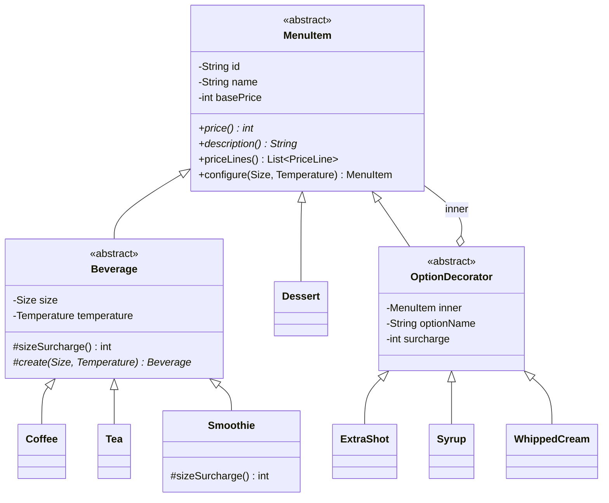
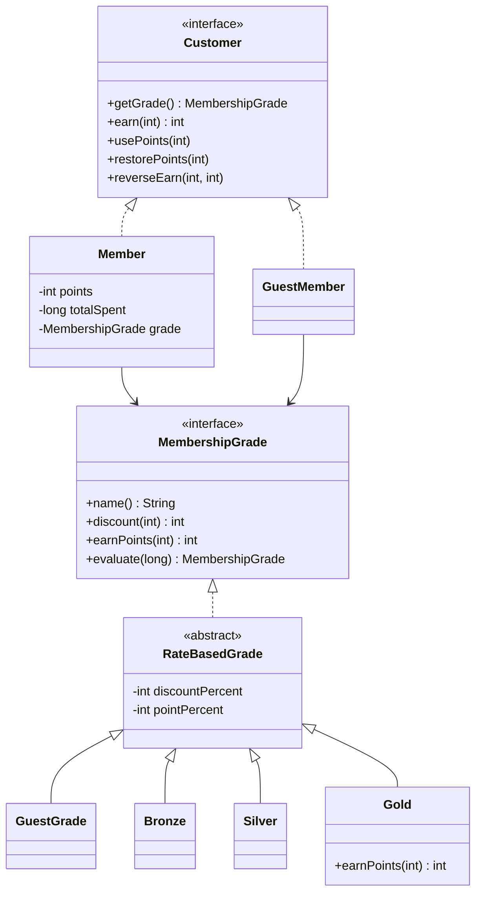
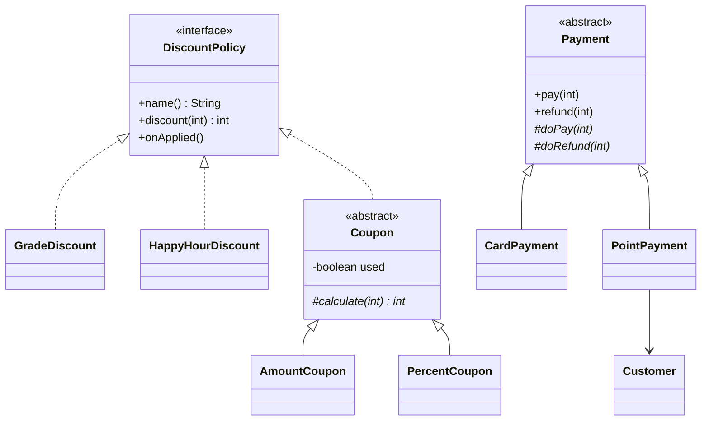
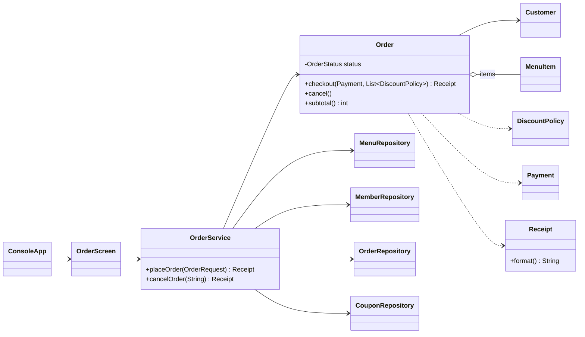

# 클래스 다이어그램 (초기 설계 v1)

## 1. 메뉴·옵션 (담당 A)

## 2. 회원·등급·포인트 (담당 B)

## 3. 할인·결제 (담당 C)

## 4. 주문·서비스 (담당 D)

## 설계 요약

| 구분 | 설명 |
|---|---|
| `domain` | 규칙과 계산을 가진 객체. UI와 저장 방식을 모른다 (`System.out` 사용 금지). |
| `repository` | 저장소 인터페이스와 메모리 구현. DB로 바꿔도 서비스는 그대로. |
| `service` | 객체를 연결만 한다. 계산이나 종류별 `if/else`를 두지 않는다. |
| `ui.console` | 입력을 받고 결과를 출력한다. 웹을 얹을 때는 `ui.web`을 추가한다. |
